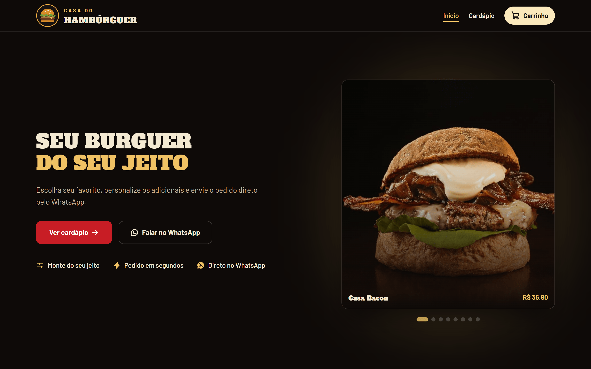
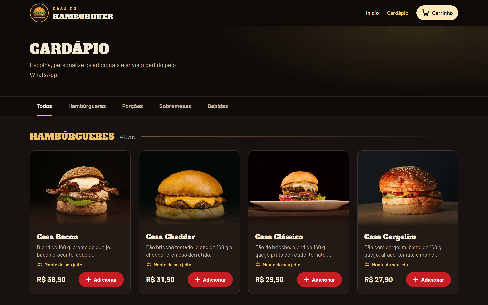
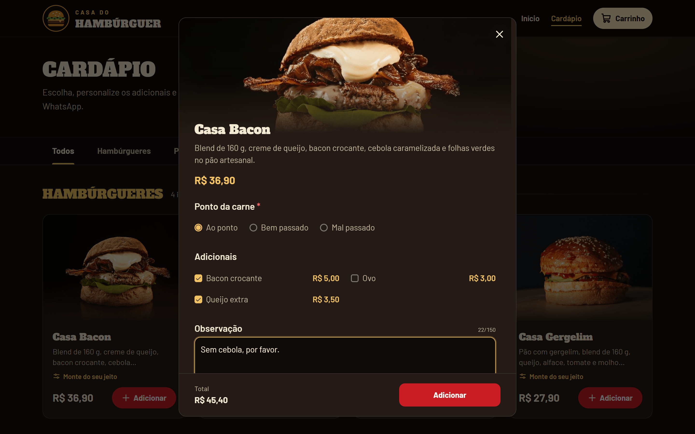
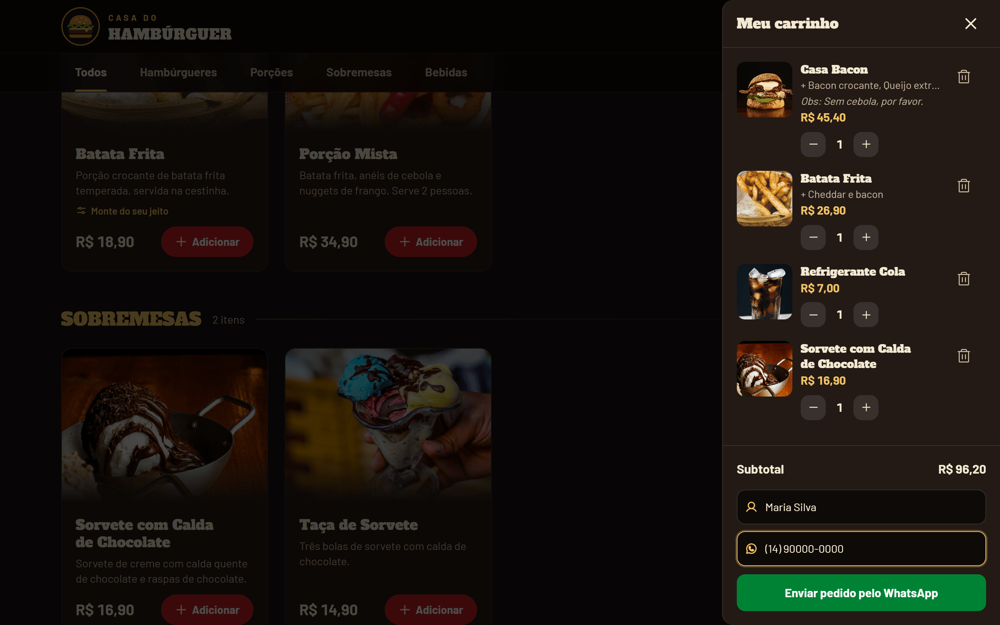
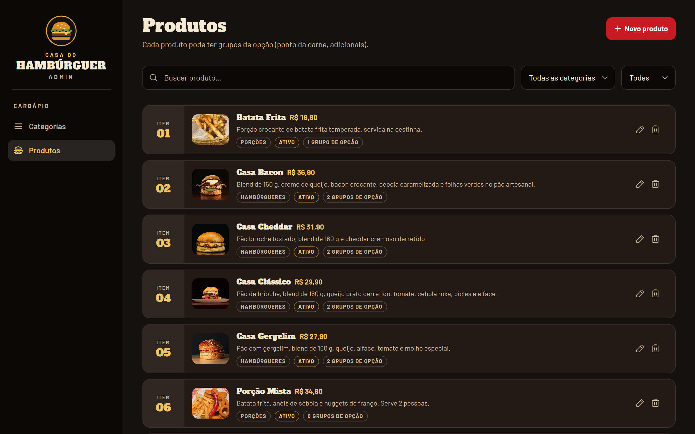
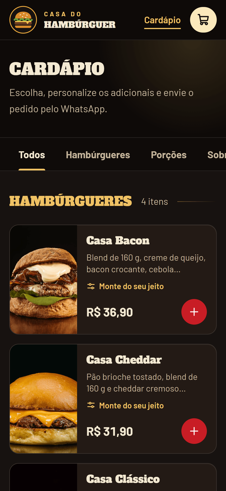
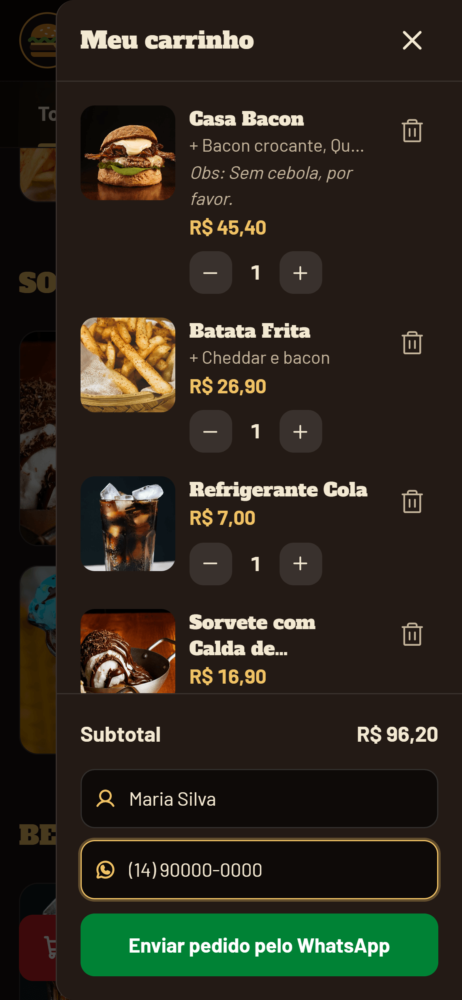

# Casa do Hambúrguer


Cardápio digital para hamburgueria: o cliente monta o pedido no carrinho e o envia pronto pelo WhatsApp.
O dono gerencia categorias e produtos em um painel administrativo protegido por login.



## Telas

### Desktop

| Cardápio | Produto |
| :---: | :---: |
|  |  |
| **Carrinho** | **Painel admin** |
|  |  |

### Mobile

| Início | Cardápio | Carrinho |
| :---: | :---: | :---: |
|  |  |  |

## Funcionalidades

### Cliente

- Página inicial com informações da loja (horário, entrega, pagamento, Instagram e WhatsApp), exibidas apenas quando configuradas no `.env`
- Cardápio com filtro por categoria, esqueleto de carregamento e botão "Tentar novamente" em caso de erro
- Modal do produto com grupos de opções de escolha única ou múltipla (com validação dos obrigatórios e preço adicional por item), observação de até 150 caracteres e quantidade
- Carrinho em drawer, persistido no `localStorage`: altera quantidade, remove itens e calcula subtotal com adicionais
- Finalização pelo WhatsApp: pede nome e telefone (com máscara), monta a mensagem do pedido e abre a conversa; o carrinho só é limpo depois que o cliente confirma o envio
- Drawer e modais com foco preso, fechamento por `Esc` e rótulos ARIA

### Painel admin

- Login com e-mail e senha; rotas `/admin/*` protegidas por guarda que consulta `/auth/me`
- Categorias: criar, renomear, desativar/reativar, reordenar (subir/descer), busca e filtro por status
- Produtos: criar, editar, desativar/reativar, upload de imagem (JPEG, PNG, WebP ou GIF, até 5 MB), busca, filtros por categoria e status e paginação
- Itens desativados deixam de aparecer no cardápio público, sem serem apagados do banco

> **Escopo atual:** os grupos de opções e seus itens (ex.: adicionais) têm CRUD completo na API, mas ainda não há tela no painel para editá-los. Os pedidos não são salvos no banco; o WhatsApp é o canal de recebimento.

## Stack

**Front-end** (`apps/web`)

- React 19, TypeScript 6, Vite 8
- Tailwind CSS 4
- React Router 7
- Zustand 5 (carrinho e autenticação)
- Phosphor Icons e Tippy.js

**Back-end** (`apps/api`)

- Node.js, Express 5, TypeScript 6 (execução com `tsx`)
- Prisma 7 (adapter `pg`) e PostgreSQL
- Zod 3 (validação), bcrypt, jsonwebtoken, multer, cookie-parser, cors

## Arquitetura

```text
casa-do-hamburguer/
├── apps/
│   ├── api/                 # API REST
│   │   ├── prisma/          # schema, migrations e seed
│   │   ├── src/
│   │   │   ├── routes/      # endpoints e middlewares aplicados
│   │   │   ├── controllers/ # entrada/saída HTTP
│   │   │   ├── services/    # regras de negócio e acesso ao Prisma
│   │   │   ├── schemas/     # validação Zod
│   │   │   └── middlewares/ # auth, upload, erros
│   │   └── uploads/         # imagens enviadas pelo admin
│   └── web/                 # SPA React
│       └── src/
│           ├── routes/      # páginas (home, cardápio, admin)
│           ├── components/  # layout, carrinho, produto, admin
│           ├── stores/      # Zustand
│           └── lib/         # http, whatsapp, formatação
├── docs/screenshots/
└── package.json             # npm workspaces
```

O front-end (porta 5173) consome a API (porta 3333) via `fetch` com `credentials: "include"`; o CORS da API aceita apenas a origem definida em `FRONTEND_URL`. A API acessa o PostgreSQL pelo Prisma. As rotas públicas (`GET /categorias`, `GET /produtos`) alimentam o cardápio; as demais exigem o cookie de sessão do admin. O carrinho vive só no navegador e, ao finalizar, vira uma mensagem de texto enviada ao número configurado em `VITE_WHATSAPP_NUMBER`.

## Decisões técnicas

- **Sessão em cookie `httpOnly`:** o JWT (expiração padrão de 7 dias) fica em cookie `httpOnly`, `sameSite: lax` e `secure` em produção, fora do alcance de JavaScript. Senhas são salvas com hash bcrypt.
- **Criação de admins restrita:** `POST /auth/register` exige estar logado, então não existe cadastro aberto. O primeiro admin nasce do seed do Prisma.
- **Validação e erros centralizados:** schemas Zod nos controllers, erros de domínio (`NotFoundError`, `ConflictError` etc.) e um `errorHandler` único que devolve `422` com a lista de campos inválidos e `404` para rotas inexistentes.
- **Soft delete:** `DELETE` em categorias e produtos apenas marca `isActive = false`, com rota de reativação. A listagem pública oculta produtos inativos e produtos de categorias inativas.
- **Modelagem de opções:** `Product → ProductOptionGroup (SINGLE | MULTIPLE, required) → ProductOptionItem (extraPrice)`, com exclusão em cascata. Preços usam `Decimal(10,2)`.
- **Upload por conteúdo:** a imagem é nomeada pelo SHA-256 do arquivo, então reenvios idênticos não duplicam arquivos; o tipo (MIME) e o tamanho são validados antes de gravar.

## Como rodar localmente

### Pré-requisitos

- Node.js (testado com a v24) e npm
- PostgreSQL com um banco vazio criado (ex.: `casa_do_hamburguer`)

### Instalação

```bash
git clone https://github.com/luizsilvabr/casa-do-hamburguer.git
cd casa-do-hamburguer
npm install
```

### Variáveis de ambiente

```bash
cp apps/api/.env.example apps/api/.env
cp apps/web/.env.example apps/web/.env
```

Edite os dois arquivos. Os nomes e valores de exemplo estão em [`apps/api/.env.example`](apps/api/.env.example) e [`apps/web/.env.example`](apps/web/.env.example). Obrigatórias: `DATABASE_URL`, `JWT_SECRET`, `SEED_ADMIN_EMAIL` e `SEED_ADMIN_PASSWORD` na API; `VITE_API_URL` e `VITE_WHATSAPP_NUMBER` (DDI + DDD + número, só dígitos) no front.

### Banco de dados

```bash
cd apps/api
npx prisma migrate deploy
npx prisma generate
npx prisma db seed
cd ../..
```

O seed cria o admin com o e-mail e a senha definidos em `SEED_ADMIN_EMAIL` e `SEED_ADMIN_PASSWORD`. Rodá-lo de novo não duplica o usuário.

### Subir os servidores

Em dois terminais, na raiz do projeto:

```bash
npm run dev:api
```

```bash
npm run dev:web
```

- Site: http://localhost:5173
- Painel admin: http://localhost:5173/admin/login
- API: http://localhost:3333

Para gerar o build do front-end: `npm run build -w web`.

## Autor

**Luíz Felipe Lopes da Silva**

[LinkedIn](https://linkedin.com/in/luizlsilva) · [GitHub](https://github.com/luizsilvabr)
